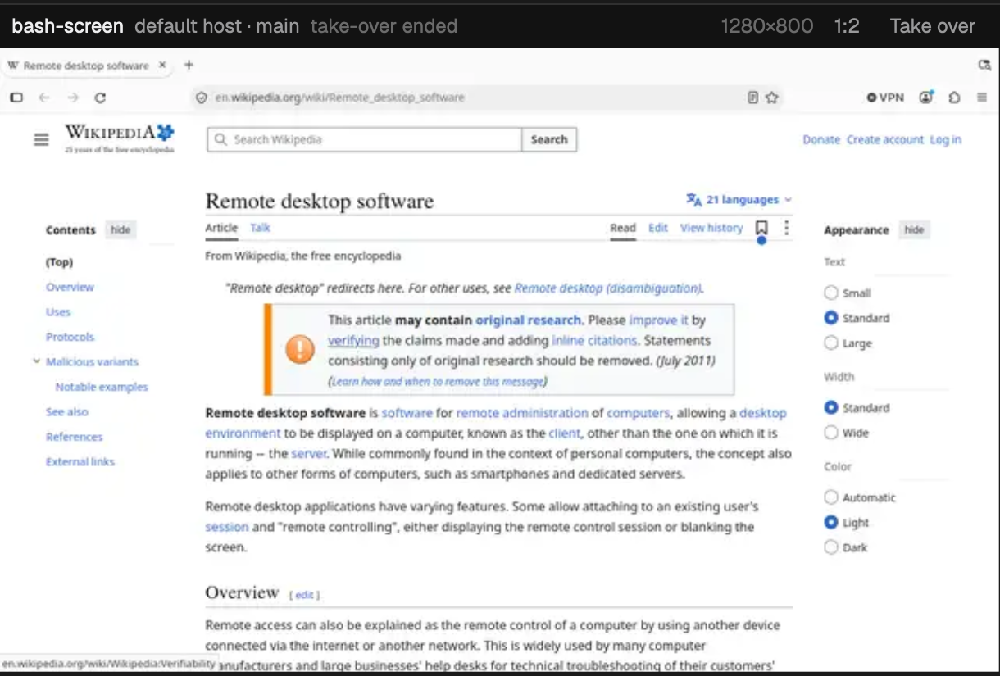

# bash-screen

Let an agent operate GUI apps on a remote Linux host over SSH, with a live
preview in the terminal. It is a plain command-line tool, and also a
[herdr](https://github.com/herdrdev/herdr) plugin that opens the preview by
itself.

Status: an early working slice. The remote host must be Ubuntu 22.04 or
later, or Debian 12 or later.

## Quick start

Install:

```sh
herdr plugin install TolemyW/bash-screen
```

Without herdr, download the binary for your system from the
[releases](https://github.com/TolemyW/bash-screen/releases) and put it on your
`PATH` as `bash-screen`.

Connect a host you can already reach with `ssh`:

```sh
bash-screen init <ssh-host>
```

This installs the remote tools, starts a screen and reads it back once as a
check. It needs no root and can be run again at any time. If the host lacks a
package, it prints the `apt-get install` command an administrator should run.

## Teach your agent

An agent can run `bash-screen` as soon as it is installed, but it will not
reach for it unprompted. Install the
[Agent Skill](skills/bash-screen/SKILL.md) so it knows when and how:

```sh
bash-screen skill --install
```

This writes the skill to `~/.claude/skills` and `~/.agents/skills`, where
Claude Code and other agents that read Agent Skills pick it up at their next
start. `--dir <skills directory>` installs it somewhere else, such as
`.claude/skills` in one project. Run it again after an update; the skill is
part of the binary and always matches its version.

You can also hand the whole job to an agent:

> Install bash-screen from https://github.com/TolemyW/bash-screen, run
> `bash-screen skill --install`, then connect the host `<ssh-host>` with
> `bash-screen init`.

Or install only the skill with the
[skills](https://github.com/vercel-labs/skills) installer:

```sh
npx skills add TolemyW/bash-screen
```

## Commands

```sh
bash-screen launch -- firefox https://example.org
bash-screen observe            # elements of the current window, each with a ref
bash-screen click e12          # a ref, or a screen position such as 640,400
bash-screen click --name Save  # or the one element with that name
bash-screen type --ref e7 hello
bash-screen key ctrl+l
bash-screen scroll --ref e40
bash-screen drag 200,300 600,300
bash-screen text               # the text of the page
bash-screen look               # screenshot saved locally as PNG
bash-screen wait --text Saved  # until an element contains the text; also --gone, --title
bash-screen stop
```

Several steps can go in one command, which saves a round trip and an
observation for each. The last step can read the result:

```sh
bash-screen do click e7 then type "Ada" then key tab return then wait --text Saved then text
```

- Every action prints what it changed in the window, or the whole list of
  elements when much changed. A ref stays with its element for as long as the
  element is in the window. Coordinates are screen pixels.
- `--name` works in place of a ref for `click`, `type` and `scroll`. It
  matches the whole name or a part of it and must match one element.
- `wait` without a condition waits until the screen stops changing. It fails
  after `--timeout` seconds (15 by default).
- In `do`, the steps are `click`, `type`, `key`, `scroll`, `drag` and `wait`,
  separated by the word `then`, and the last one can be `text` or `look`.
  Their refs are the ones you saw before the command. If a step fails, the
  ones after it are not run, and the error comes with the window as it is.
- `--json` on any command gives the reply as one line of JSON. For `look` the
  JSON names the saved file.
- If an app misbehaves when its elements are read, start it with
  `bash-screen launch --no-a11y -- <app>`. `observe` then does not see it;
  work from `look` and positions instead.

## Preview

While you watch the remote screen, the agent can read the page with
`bash-screen text` and locate form controls with `bash-screen observe`.
It can fill a field by ref, check the returned changes, and read validation
messages or a submission receipt as text. Use `look` when the task calls
for a visual check, such as identifying which control a dialog covers.

For a full-resolution HTML viewer, run:

```sh
bash-screen web --open
```

This starts a local server and opens its URL in your browser. It needs Python 3
on the local machine, with no extra packages. The viewer provides fit-to-window
and 100–200% zoom, pause, full screen, recent actions, and optional mouse and
keyboard control. Use **Send text** for paste or input methods. Screenshots use
full screen resolution with WebP compression; refreshes and input use SSH.
Browser-reserved shortcuts may stay local, and mouse dragging is not supported.
`Ctrl+C` stops the viewer while the remote apps keep running.

Inside herdr or the Herdr desktop app, the first command opens a preview pane
next to the pane that ran it. Anywhere else, run `bash-screen preview` in a
terminal of your own.

Terminals without image support use compatible quadrant block characters.
The character preview sharpens edges and chooses each cell's two colours to
preserve colour boundaries. Smaller terminal fonts provide more cells and
therefore more detail. The resolution keys below affect image previews; they
cannot add detail beyond the cell grid in a character preview.

To keep character rendering even in a terminal with image support:

```sh
BASH_SCREEN_PREVIEW_BLOCKS=quad bash-screen preview
```

In the preview pane:

| Key | Effect |
|---|---|
| `+` `-` | Sharper or coarser picture |
| `1` to `4` | A specific resolution: 320, 640 or 960 pixels, or the full screen |
| `i` | Take control: clicks, the wheel, typed and pasted text and key combinations go to the remote screen |
| `Ctrl+]` | Hand the keys back to the preview |

While you are in control the heading is red. Each input takes one SSH round
trip, so expect a fraction of a second between a click and the picture
changing. For anything finer, `bash-screen vnc` prints how to attach a VNC
client.

### A native pane in the Herdr desktop app

The preview above is drawn in a terminal. The Herdr desktop app can also show
the screen as a pane of its own, with a [mod](herdr-app/RECIPE.md):



```sh
git clone https://github.com/TolemyW/bash-screen
sh bash-screen/herdr-app/install.sh
herdr-app do pane.split '{"direction":"right","mod":"bash-screen"}'
```

Or ask an agent in the Herdr app to add the mod from this repository.

Once the mod is installed, the pane that a command opens beside an agent's
terminal is this one instead of the terminal preview, and it follows the
session that terminal last used. No second pane is opened while one already
shows that session.

- The pane only shows the screen until you press `Take over`. Then a click on
  the picture clicks there on the remote screen and gives the pane the
  keyboard. Typed text, Enter, the arrows and combinations with Ctrl or Alt
  then go to the remote screen, and the wheel scrolls it. `Hand back` or
  `Ctrl+]` ends it.
- The header shows what the last action did and how long the picture took to
  answer, usually about a second.
- The most recent actions, the agent's and yours, are listed in the room the
  picture leaves: under it, or beside it in a wide pane.
- `1:2` / `1:1` switches between half-size and full-size pictures.
- While taken over, `VNC` opens an SSH tunnel for a VNC client and keeps it
  until `Hand back`.
- Another host or session: add `"props":{"host":"other-host","session":"research"}`
  to the `pane.split` arguments.

The mod runs the `bash-screen` CLI for everything, so `bash-screen init` must
have been run first. It needs `bash-screen` 0.5.2 or later.

## Several hosts or screens

Commands act on the default host, which is the first one you `init`, and its
session `main`. A session is a separate screen with its own apps, browser
profile and action log, so several agents can share one host without seeing
each other.

```sh
bash-screen init other-host                         # a second host; the default stays
bash-screen --host other-host observe
bash-screen --session research launch -- firefox    # a second screen on the default host
bash-screen sessions                                # what is running on the host
bash-screen --session research stop
```

- `BASH_SCREEN_HOST` and `BASH_SCREEN_SESSION` select the same things for a
  whole shell, which is the easy way to give each agent its own session.
- The host `local` is this machine, reached without SSH.
- Stopping a session keeps its browser profile; `stop --forget` deletes it.

## More

- [docs/reference.md](docs/reference.md): how it works, remote host requirements,
  configuration, environment variables and known limits.
- [CONTRIBUTING.md](CONTRIBUTING.md): building from a checkout and where
  things are in the repository.

## License

Apache-2.0. See `LICENSE`.
