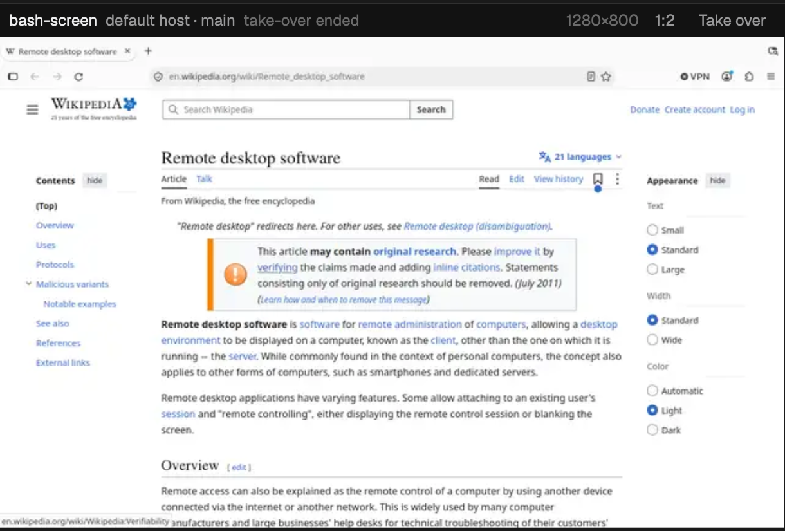

# bash-screen

A pane that shows the screen of a remote Linux machine, the one a coding agent is driving through the [bash-screen](https://github.com/TolemyW/bash-screen) CLI. The person watches what the agent does in the browser or desktop app over there, and can click, type and scroll on the picture to help.

## What you see

- **Header**, 26 px high, `chrome` background, 12 px text, left to right:
  - `bash-screen` in `foreground`.
  - The host and session, `default host · main` unless the block's props name others, in `muted`.
  - What the last action did (`click 640,400`, `type 5 chars`, `key ctrl+l`), in `dim`, taking the free space and truncated.
  - The remote screen's size (`1280×800`) in `dim`; `connecting …` before the first picture; `not connected` in `blocked` when the CLI fails.
  - Two text buttons, `muted`, `raised` background on hover: `1:2` / `1:1` and `Take over`.
- **Header while taken over**: the same 26 px row, so the picture does not move. `selected` background; `Taken over` in semibold, `VNC on localhost:<port>, no password`, the last action, and the buttons `Open viewer` and `Stop` in place of the size and the two usual buttons.
- **Picture**, under the header: the remote screen, as large as fits with its proportions kept, centred horizontally and aligned to the top. Before the first picture: `Waiting for the first picture …` in `dim`; on failure, the CLI's error text in `blocked`.

## How it behaves

- Every 1.5 s the mod takes a screenshot. When the screen has not changed, nothing is redrawn.
- A changed picture replaces the old one without a blank moment in between.
- A left press on the picture clicks that point on the remote screen and gives the pane the keyboard.
- The press leaves a 14 px ring at that point. It pulses in `accent` until the outcome is known, then stays for 0.9 s in `done` when the picture changed after the click, or in `blocked` when it did not or the click could not be sent.
- With the keyboard on the pane, typed characters are typed remotely; Enter, Backspace, Escape, Tab, Delete, the arrows, Home, End, Page Up and Page Down, and combinations with Ctrl and Alt are sent as keys. Combinations with Cmd are left to the app.
- The wheel over the picture turns the remote wheel, one notch per 40 px of travel.
- Actions go out in order, each batch in one call. Whatever is done while a call is on its way goes out together in the next. After a batch the mod looks again at once and three more times 0.3 s apart, so the answer shows without waiting for the timer.
- `1:2` / `1:1` switches between half-size and full-size screenshots; the choice is remembered per pane.
- `Take over` opens an SSH tunnel to the session's VNC socket and keeps it open. A notification says so, the address goes to the clipboard, and the header stays in its taken-over form until `Stop`, which closes the tunnel and says so in another notification. `Open viewer` opens `vnc://localhost:<port>` with the system's viewer. Closing the pane closes the tunnel; a reload of the mod keeps it.
- It does not follow agent statuses and has no key commands of its own.

## Built from

- `mods/bash-screen/` (`mod.json`: `{ "place": "none", "focusable": true }`): the pane. Props: `host`, `session`, both optional; they become the CLI's `--host` and `--session`.
- `mods/bash-screen-frame/` (`place: none`): a mod that draws an empty `div()`. Its folder holds the pictures.
- Open it with `pane.split {direction, mod: "bash-screen", props}` or as a layout block.
- `herdr`: `exec`, `theme`, `appHome`, `props`, `checking`, `nextCommand`; `cx.timer.every`, `cx.timer.after`, `cx.focus_handle`, `cx.write_to_clipboard`, `localStorage`.
- Programs it runs: `bash-screen` (`look --scale <s> -o <file> --json`, `input <JSON list of actions>`, `vnc`); `ssh` in the background for the take-over tunnel, with `kill` to end it; `open` or `xdg-open` for the viewer; and `sh`, `cmp`, `cp`, `mv`, `rm`, `mkdir`, `nohup`, `sleep` around them. `bash-screen` and the tunnel connect to the remote host over SSH. Nothing else reaches the network.
- Files it writes: `data/bash-screen/<id>-next.png` and `<id>-last.png`, `mods/bash-screen-frame/<id>-a.png` and `<id>-b.png`, all under the app's home; `<id>` is random per pane and the four files are removed when the pane closes.
- One `sh -c` script per screenshot: take it into `data/`, `cmp` it with the last published one, and only when different copy it to `-last` and `mv` it to the picture that is currently behind.
- The picture area is a `relative()` box holding two `image()` elements, both `absolute()` at 0,0 and the same size, the current one drawn last. 0.5 s after a change is saved to the one behind, the two swap order (the app shows a saved picture 0.2 to 0.45 s later; a shorter wait shows the picture from two changes ago for a moment).
- Press position: `event.local_position` of `on_mouse_down("left")` on the box, divided by the box's size, times the remote size from the CLI's reply (`screen`).

## Watch out

- `image()` caches by path. A picture saved under `data/` never updates on screen; a hidden file does not either.
- A file saved anywhere inside a mod's own folder, subfolders included, restarts that mod. Pictures saved in the pane's own folder leave it stuck on `Waiting for the first picture …`. That is why a second, empty mod owns them.
- Showing one picture file and overwriting it flashes on every change. Keep two and write to the hidden one.
- `mv` into place, never write the PNG in place: the app may read a half-written file.
- Without the screenshot comparison the whole window redraws every 1.5 s. A page with a blinking caret or a clock still changes every time.
- Use `bash-screen input`, not `click`, `type` and `key`: those read the whole window back after each action and take three times as long. `input` needs bash-screen 0.4.0 or later.
- Text starting with `-` fails remotely, so leading dashes are sent as `minus` key presses and the rest as text.
- The tunnel's process id is kept in `localStorage`, and checked with `kill -0` on start: a reload of the mod must not lose a running tunnel, nor show one that has died.
- Each batch is one SSH round trip, around half a second, and the picture follows about a second later: fine for helping out, too slow for working in; that is what `Take over` is for. Text composed with an input method does not arrive; only plain key presses do.
- `exec`, and so the screenshot, also runs during `herdr-app check`: return from `init` early when `checking()`.
- It assumes `bash-screen` is on `PATH` and a default host is configured (`bash-screen init <host>`).

## Done when

- `herdr-app check` passes for both mods.
- With a session running, the pane shows the remote screen within a few seconds and the header shows its size.
- Opening a new tab in the remote browser shows up in the pane within about three seconds, with no blank frame.
- A press on a remote link opens it; the header says `click x,y`.
- Typing `hello` and Enter with the pane focused types into the remote field.
- With a static remote screen, `mods/bash-screen-frame/*.png` stop changing.
- Closing the pane removes its four files.
- `Take over` shows a notification and the bar; a VNC client connects to the port; `Stop` removes the bar and the `ssh` process is gone.
